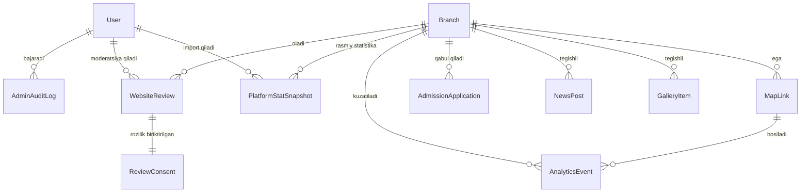

# Turon Odob-Ilm Raqamli Maktab Platformasi — Arxitektura Hujjati

## 1. Loyiha strukturasi

```text
turon-odob-ilm/
├── manage.py
├── requirements.txt
├── .env.example
├── .gitignore
├── README.md
├── docs/
│   ├── ARCHITECTURE.md
│   └── BACKUP_AND_DEPLOY.md
├── config/
│   ├── settings/
│   │   ├── __init__.py
│   │   ├── base.py
│   │   ├── dev.py
│   │   └── prod.py
│   ├── urls.py
│   ├── wsgi.py
│   └── asgi.py
├── apps/
│   ├── accounts/      # Rollar (Superadmin, Muharrir, Fikr moderatori), AdminAuditLog, login himoyasi
│   ├── core/          # SiteSettings, Bosh sahifa, Maktab haqida, Aloqa, Maxfiylik, SEO, rate limiting
│   ├── branches/      # Branch (Furqat + kelajakdagi filiallar), MapLink, xavfsiz xarita redirect
│   ├── content/       # Ta'lim, xizmatlar, o'qituvchilar, hujjatlar, yangiliklar, galereya, qabul
│   ├── reviews/       # WebsiteReview, ReviewConsent, neytral fikr oqimi va moderatsiya
│   ├── analytics/     # AnalyticsEvent (PII-siz), PlatformStatSnapshot, Google/Yandex adapterlar
│   └── reports/       # Admin monitoring dashboard, XLSX/CSV/chop etish hisobotlari, qo'lda import
├── templates/         # Mobil-first Django Templates (o'zbek lotin yozuvida)
├── static/            # CSS, JS, Chart.js fallback, SVG maktab emblemasi
├── media/
└── logs/
```

## 2. ER Diagramma



## 3. URL Xaritasi

- `/` — Bosh sahifa
- `/maktab-haqida/` — Maktab haqida, o'qituvchilar, infratuzilma, rasmiy hujjatlar
- `/talim/` — Ta'lim va xizmatlar (sinflar, fanlar, to'garaklar, kun tartibi, ovqatlanish, transport)
- `/yangiliklar/`, `/yangiliklar/<slug>/` — Yangiliklar va tadbirlar
- `/galereya/` — Foto va video galereya
- `/qabul/` — Qabul shartlari, hujjatlar va ariza formasi
- `/filiallar/`, `/filiallar/<slug>/` — Filiallar va manzil
- `/filiallar/<slug>/xarita/<id>/` — Xarita havolasiga xavfsiz redirect + klik analitikasi
- `/fikrlar/` — Ota-onalar fikrlari va Google/Yandex sharh havolalari
- `/aloqa/` — Aloqa va murojaat formasi
- `/maxfiylik-siyosati/` — Maxfiylik siyosati
- `/sitemap.xml`, `/robots.txt` — SEO fayllari
- `/boshqaruv/...` — Administrator monitoring portali (Dashboard, Statistika, Platforma ko'rsatkichlari, Fikrlar moderatsiyasi, Filiallar, Kontent, XLSX/CSV/Chop etish eksporti, Audit log)
- `/admin/` — Django Admin

## 4. Asosiy xavfsizlik va halollik tamoyillari

1. **Open Redirect himoyasi:** Xarita redirect URL hech qachon query parametr sifatida olinmaydi. Faqat admin kiritgan faol `MapLink` obyektidan olinadi va Google/Yandex uchun qat'iy HTTPS domen allowlistidan o'tkaziladi.
2. **Soxta sharh va baho manipulyatsiyasiga yo'l qo'ymaslik:** Saytda hech qanday review gating (salbiy bahoni yashirib faqat ijobiysini xaritaga yo'naltirish), avtomatik sharh yuborish yoki soxta izoh generatsiyasi mavjud emas.
3. **Ma'lumot shaffofligi:** Saytdagi tugma bosishlari alohida, Google/Yandex kabinetlaridagi rasmiy ko'rsatkichlar esa manbasi va oxirgi yangilanish vaqti bilan alohida saqlanadi va ko'rsatiladi.
4. **Shaxsiy ma'lumotlar himoyasi:** Ota-onaning telefon raqami ommaviy saytga chiqarilmaydi; `AnalyticsEvent` faqat anonim sessiya xeshini saqlaydi.
